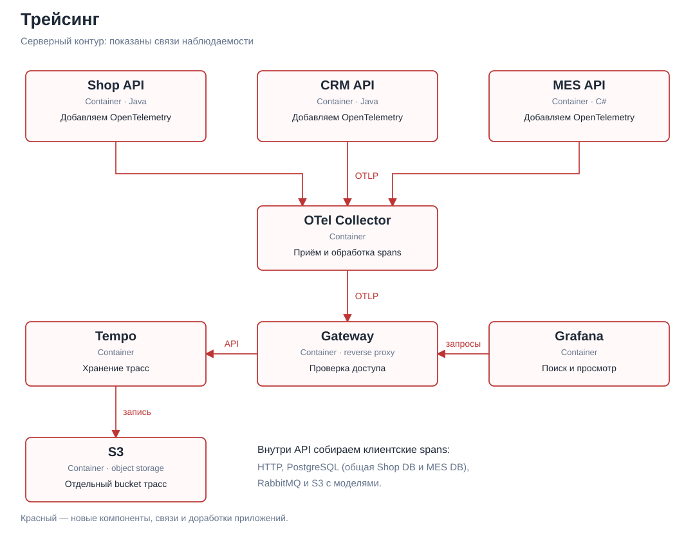

# Архитектурное решение по трейсингу

## Мотивация

Трейсинг поможет по номеру заказа определить, на каком этапе возникла задержка: загрузка модели, расчёт, обмен сообщениями или изменение статуса. Поддержка быстрее ответит клиенту, разработчик увидит проблемный вызов и его зависимости.

Эффект оцениваем по трём показателям: времени локализации инцидента, доле заказов с полной диагностической цепочкой и числу обращений о статусе на 100 заказов. Снижение числа обращений зависит от исправления найденных причин, а не только от сбора traces.

## Покрытие и состав данных

Магазин и CRM используют общую PostgreSQL, MES — отдельную. Трейсинг нужен во всех трёх API и в обработчиках RabbitMQ. Базы, брокер и S3 покрываем spans вызывающих клиентов.

| Участок | Возможный сбой |
|---|---|
| Shop API → PostgreSQL/S3 | Заказ сохранён, но модель недоступна |
| MES API: приём B2B и расчёт | Повтор запроса после таймаута, ожидание ресурсов, ошибка вычисления |
| CRM/MES → RabbitMQ → consumer | Ошибка публикации, потеря сообщения, повторная доставка или сбой обработки |
| MES: список и назначение заказа | Медленный SQL, конфликт двух операторов |
| CRM: подтверждение и закрытие | Недопустимый переход или необработанное уведомление перевозчика |

В trace записываем:

- `trace_id`, `span_id`, родительскую связь или span link, начало, длительность и результат операции;
- сервис, версию приложения и окружение;
- `order_id`, канал B2C/B2B, статус до/после и версию заказа;
- `event_id`, тип события, очередь, номер попытки, результаты publish/confirm и обработки/ack;
- метод и шаблон HTTP-маршрута, код ответа, операцию БД, тип ошибки;
- идентификатор задания, класс сложности модели, время ожидания и выполнения расчёта.

## Предлагаемое решение

Java-приложения подключаем через OpenTelemetry Java agent, MES — через .NET SDK. Бизнес-переходы и обработчики сообщений инструментируем вручную. Spans передаются по OTLP через Collector и аутентифицирующий gateway в Tempo, хранятся в отдельном S3 bucket и доступны через Grafana. Для пилота используем Tempo 2.10.x без Kafka; перед production проверяем поддержку выбранной версии.

[Редактируемая C4-схема](../diagrams/tracing.drawio). Красным выделены новые компоненты, связи и доработки приложений.

Контекст W3C передаём в HTTP-заголовках и headers RabbitMQ, сохраняем вместе с outbox-событием. Асинхронный этап создаёт отдельный trace со ссылкой на исходную операцию; история объединяется по `order_id`. Один trace на весь многонедельный заказ не нужен.

Создание заказа, переходы статусов, доставку событий и расчёт сохраняем полностью. Traces храним 14 дней. Экспорт асинхронный, с ограниченным буфером: сбой сбора не останавливает заказы. Последнее подтверждённое состояние проверяем по журналу переходов в PostgreSQL: диагностические данные могут потеряться.

## Компромиссы

Трейсинг не восстанавливает сообщения. Отсутствие span может означать как сбой операции, так и сбой экспорта. Клиентские spans не раскрывают внутреннюю работу managed PostgreSQL, S3 и системы перевозчика. Браузерные ошибки до обращения к API требуют отдельного покрытия; его откладываем до серверного пути. После удаления старых traces остаётся журнал статусов, но подробности вызовов недоступны.

## Безопасность

Collector, Tempo и bucket находятся в приватной сети; передача защищена TLS. Grafana использует корпоративный вход с MFA: поддержка и разработчики читают разрешённое окружение, DevOps управляет настройками. Gateway проверяет права на данные; партнёрам доступ не предоставляется.

В traces запрещены телефоны, адреса, токены, тела запросов, модели, SQL-параметры и signed URL. Входящий внешний trace-контекст проверяем, произвольный baggage отбрасываем. Доступ и изменения конфигурации журналируем.
