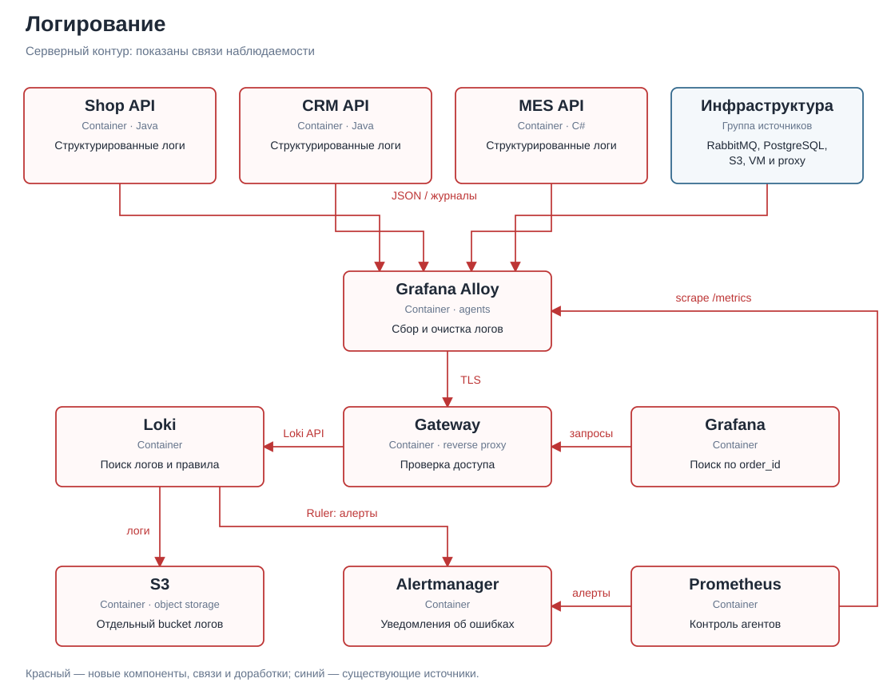

# Архитектурное решение по логированию

## Мотивация

Централизованные логи позволят разбирать сбой по номеру заказа, без пересказа клиента и ручного поиска на серверах. Поддержка увидит причину отказа, разработчик сможет связать её с trace и версией приложения.

Сравниваем время диагностики, долю обращений, решённых поддержкой без разработчика, и повторные обращения по заказу до внедрения и после исправлений.

## Источники и события

Собираем логи Shop API, CRM API, MES API и расчёта, RabbitMQ, reverse proxy и VM. Для общей Shop DB и отдельной MES DB подключаем доступные журналы managed PostgreSQL; для S3 — журнал обращений либо логи клиентских вызовов. Ошибки Vue/React отправляются через ограниченный endpoint своего API.

Общие поля JSON: время UTC, уровень, сервис, версия, окружение, имя события, `request_id`, `trace_id` и `span_id`.

| Событие INFO | Дополнительные поля |
|---|---|
| Заказ создан или отправлен | `order_id`, канал, статус, версия, результат commit |
| Модель принята и проверена | `order_id`, `file_id`, размер, версия, результат проверки |
| Статус изменён | `order_id`, статус до/после, версия, внутренний `actor_id` |
| Событие опубликовано, обработано или признано повтором | `event_id`, очередь, попытка, confirm/ack, результат commit |
| Расчёт начат или завершён | `order_id`, `job_id`, ожидание, длительность, результат |
| Оператор попытался взять заказ | `order_id`, `actor_id`, версия, успех или конфликт |
| Заказ закрыт | `order_id`, источник подтверждения, результат |
| HTTP-запрос завершён | Шаблон маршрута, метод, код, длительность |
| Сервис запущен или обновлён | Версия, instance, идентификатор выкладки |

Смену статуса логируем после commit. Подтверждённую историю сохраняем в БД: файл логов может потеряться при сбое процесса.

`WARN` используем для временных ошибок зависимостей и повторов, `ERROR` — для окончательного отказа или попадания сообщения в DLQ. `DEBUG` включаем для расследования на ограниченное время; `TRACE` оставляем для dev. Бизнес-события и ошибки сохраняем полностью, успешные массовые GET — с выборкой 10%.

## Очерёдность логирования и трейсинга

Сначала покрываем MES, RabbitMQ и CRM consumer: здесь заказ партнёра может не появиться в CRM. Логируем приём, расчёт и переходы; traces связывают публикацию с обработкой. Затем добавляем путь магазина, S3, SQL и дашборд MES. Подробное покрытие браузеров выполняем последним; минимальные ERROR-логи всех API нужны с первого этапа.

## Предлагаемое решение

Java пишет JSON через Logback, C# — через Serilog. Grafana Alloy собирает записи на VM, очищает поля и отправляет их через gateway в Loki. Данные хранятся в отдельном S3 bucket; Grafana позволяет искать по `order_id` и переходить к Tempo по `trace_id`. Буферы и ротация ограничены: недоступность логирования не должна останавливать приложение.

[Редактируемая C4-схема](../diagrams/logging.drawio). Красным выделены доработки, новые компоненты и связи.

### Безопасность

Не записываем персональные данные покупателя, токены, cookies, тела запросов, модели, SQL-параметры и signed URL. Приложения используют разрешённый набор полей, Alloy дополнительно очищает записи. Сервисы доступны в приватной сети по TLS.

Вход в Grafana — через корпоративную учётную запись с MFA. Поддержка читает обезличенные записи, уполномоченные разработчики — диагностику prod, DevOps управляет сбором. Gateway проверяет доступ к отдельным tenants prod, non-prod и аудита; аудит доступен отдельной группе. Партнёрам доступ закрыт, административные действия журналируются.

### Хранение

В Loki разделяем потоки по `environment`, `service`, `level`, `category`; отдельный полнотекстовый индекс на систему не создаём. Идентификаторы заказов и traces остаются полями записи, чтобы не увеличивать индекс.

Предлагаемые сроки: prod INFO/WARN/ERROR — 30 дней, DEBUG — 3 дня, dev/release — 7 дней, аудит — 90 дней. Удаление выполняет Compactor; lifecycle bucket не удаляет данные раньше него.

Оценка при 50 записях/с по 1 КБ: 129,6 ГБ за 30 дней до сжатия; при сжатии 3:1 и запасе 50% — 64,8 ГБ. Аудит, non-prod, индексы и буферы считаются дополнительно. Это допущение, которое заменяем замером.

### Анализ и алерты

Сохраняем запросы для истории заказа, повторных доставок, ошибок расчёта и конфликтов назначения. Loki Ruler передаёт в Alertmanager ошибки сохранения заказа и попадания в DLQ. Prometheus контролирует доступность агентов и задержку доставки логов.

Всплеск уникальных созданий выше 10-кратной медианы за 7 дней и выше 100 за минуту вызывает проверку партнёрского потока и повторов. Он не доказывает DDoS: автоматическую блокировку по одному сигналу не вводим. У каждого алерта есть владелец и ссылка на логи.
