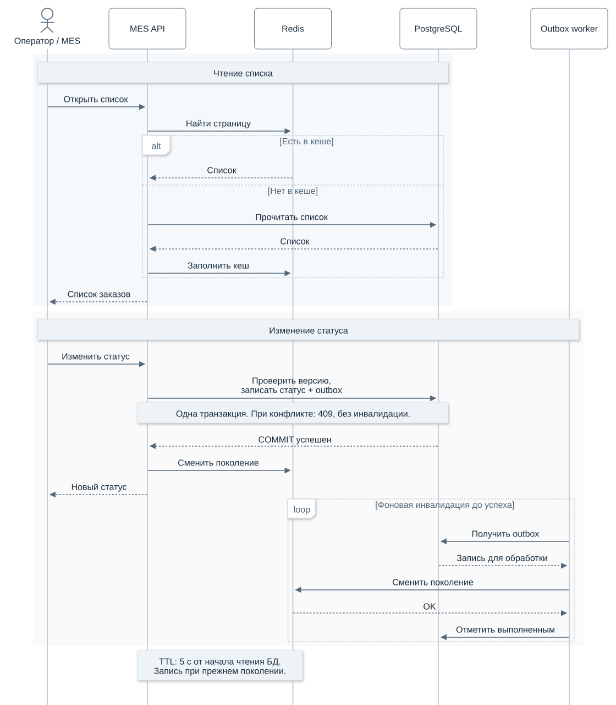

# Архитектурное решение по кешированию

## Мотивация

В MES операторы часто открывают первую страницу списка заказов, чтобы взять новые заказы в работу. Кеширование этой страницы сократит повторные запросы к PostgreSQL и должно ускорить интерфейс. Перед внедрением проверяем медленные SQL и индексы: кеш не устранит блокировки или конкуренцию с расчётом стоимости за CPU.

Кешируем первую страницу общих списков по статусу и фильтру «Активные». Стоимость изделия пока не кешируем: для уникальных моделей повторное использование результата не даст выигрыша, а при изменении модели или цен результат нужно пересчитывать.

## Предлагаемое решение

### Вид кеширования и паттерн

Выбираем серверный Redis с паттерном Cache-Aside: MES API ищет ответ в кеше, при промахе читает PostgreSQL и сохраняет результат. Общий кеш обслуживает всех операторов и несколько экземпляров API. Клиентский кеш создавал бы отдельные устаревающие копии в браузерах и не сокращал бы повторные чтения разных операторов. Для ответов списка устанавливаем `Cache-Control: no-store`.

| Паттерн | Оценка для MES |
|---|---|
| Cache-Aside | Заполняет только востребованные страницы; подходит для повторных чтений списка |
| Write-Through | Каждое изменение статуса потребует пересчёта нескольких списков и первых страниц; это увеличит время записи |
| Refresh-Ahead | Потребует фонового обновления даже без активных операторов; при коротком TTL добавит лишние запросы к БД |

Cache-Aside допускает расхождения с БД, поэтому актуальность ограничиваем инвалидацией и TTL. [Описание паттерна](https://learn.microsoft.com/en-us/azure/architecture/patterns/cache-aside).

### Содержимое и обновление кеша

Храним краткие данные первых 50 заказов: идентификатор, статус, версию, время создания и признак назначения. Сортировка — `created_at DESC, id DESC`. В ключ входят окружение, область видимости операторов, фильтр, сортировка, размер страницы и поколение кеша. Контакты покупателей и 3D-файлы в кеш списка не попадают. Последующие страницы и персональные выборки читаем из БД.

Используем программную инвалидацию вместе с TTL 5 с. Поколение — случайный UUID для области видимости; при отсутствии создаём его через `SET NX` и перечитываем значение. После изменения заказа API фиксирует новый статус, версию и событие outbox одной транзакцией PostgreSQL, затем меняет поколение в Redis. Старые страницы становятся недоступны по новым ключам. Если Redis недоступен или API остановился после commit, обработчик outbox повторяет инвалидацию. Каждая попытка устанавливает новый UUID; обработанное событие отмечается только после успеха.

При промахе API запоминает поколение и время начала SQL-запроса `as_of`. Lua-скрипт атомарно проверяет, что поколение не изменилось, и записывает страницу только в ключ этого поколения. Срок истечения — `as_of + 5 с`. Так читатель, начавшийся до изменения статуса, не заполнит новый кеш старым результатом. Для расчёта возраста синхронизируем часы; просроченные данные не отдаём. Уже начавшееся чтение может вернуть предыдущее состояние: строгой согласованности списка нет.

Один TTL оставлял бы старую страницу после каждой записи. Простое удаление ключа допускает его повторное заполнение старым результатом, а инвалидация только через Pub/Sub может потеряться при отключении подписчика. Поколения с outbox защищают от этих сбоев, TTL ограничивает срок жизни прежних страниц.

Назначение оператора всегда выполняется условным UPDATE в PostgreSQL по статусу и ожидаемой версии. Если заказ уже изменён, API возвращает `409 Conflict`. Кеш не определяет, кому достанется заказ. После успешной записи интерфейс обновляет строку и перечитывает список; активная первая страница также обновляется каждые 5 с. При отказе Redis читаем БД с ограничением параллельных запросов.

### Диаграмма последовательности

[Схема в полном размере](../diagrams/caching-sequence.svg) · [Исходник Mermaid](../diagrams/caching-sequence.mmd).

Outbox хранится в MES DB. Его worker повторяет инвалидацию независимо от публикации бизнес-событий в RabbitMQ.
